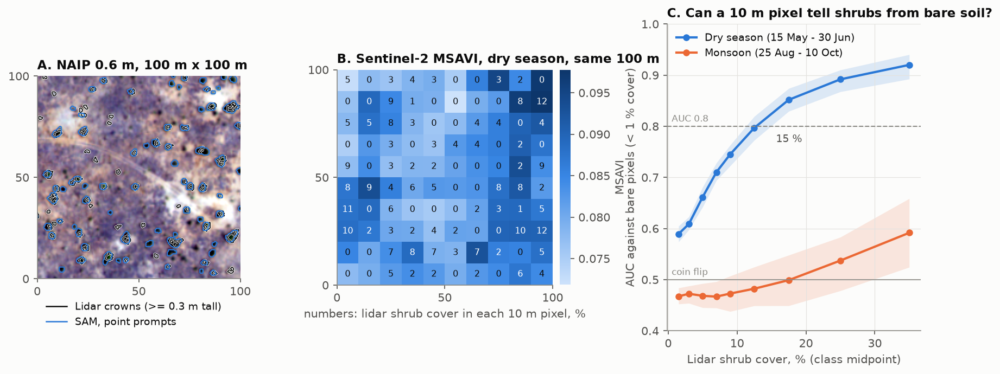
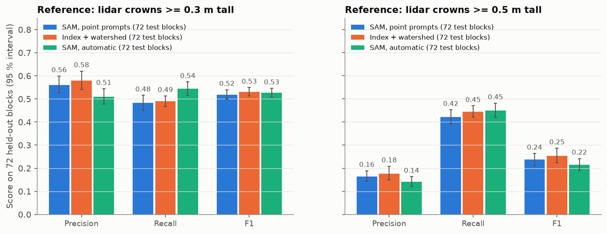
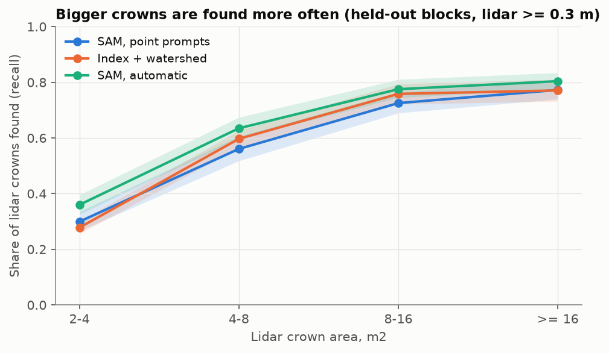
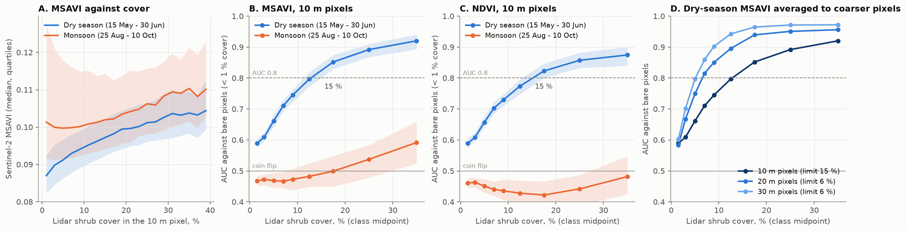
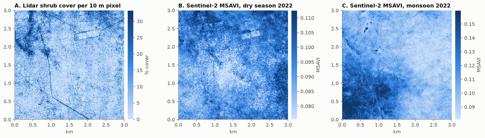
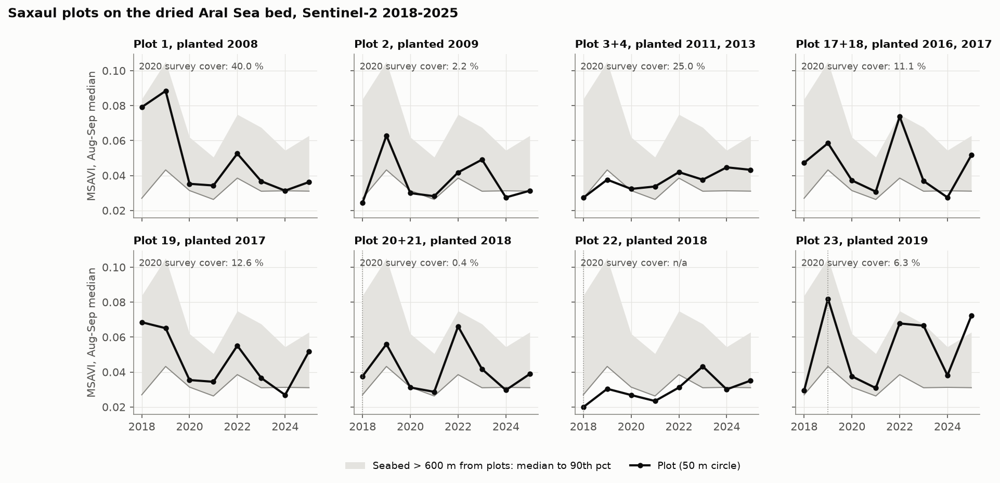
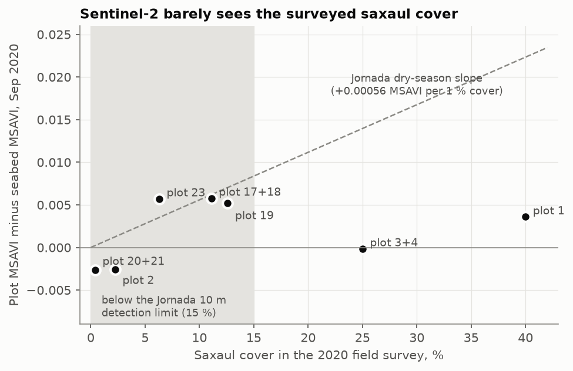

# Counting desert shrubs from the air, and what Sentinel-2 can see of them

This project counts and measures shrub crowns on 0.6 m aerial imagery in a Chihuahuan Desert shrubland, checks every crown against airborne lidar, and then asks the question that matters for monitoring sparse woody cover from space: **below what shrub cover does a 10 m Sentinel-2 pixel stop seeing shrubs at all?** The site is a 3 km × 3 km box at the NEON Jornada site in southern New Mexico, where honey mesquite, creosotebush and tarbush stand on bare, sandy soil. Two crown detectors are compared on USDA NAIP imagery: Segment Anything (SAM) in two modes, and a simple vegetation-index threshold with a watershed split. The reference is 114,481 crowns that I derive from a 35 points/m² NEON lidar point cloud. A short add-on applies the result to saxaul plantings on the dried Aral Sea bed in Kazakhstan.

## Summary

- **Question:** How well can shrub crowns be counted and sized on sub-metre four-band imagery, and at what shrub cover does a 10 m Sentinel-2 pixel separate shrubland from bare soil?
- **Answer:** On 72 held-out 250 m blocks, all three detectors found about half of the lidar crowns, with F1 0.52 to 0.53 (95 % intervals overlapping; SAM was no better than the index baseline). Crowns of 8 m² and more were found 73 to 80 % of the time, crowns of 2 to 4 m² only 28 to 36 %. In the dry season a 10 m Sentinel-2 MSAVI pixel separated shrub cover from bare soil (AUC ≥ 0.8) only from **about 15 % cover**, and from about 6 % when pixels were averaged to 20 or 30 m. In the monsoon, grass green-up hid the shrubs completely (AUC at most 0.59).
- **Main limitation:** The reference is lidar height, not field-checked crowns. It reads shrub heights low and splits touching crowns with a model, and the main reference height (0.3 m) is a choice: at 0.5 m every F1 falls to 0.22 to 0.25.



## My role

I'm a geographer: B.S. in Geography with a GIS background, now an M.S. Geography student at Texas A&M. I ran this project as the human on the loop. I owned the question, the standards and every decision about what gets published, and used Claude Code (Anthropic) as the programmer.

- **Problem framing:** I defined the question, approved the study area and data, and set what a useful, defensible answer looks like.
- **Key call:** test crown detection against an independent lidar reference instead of the image itself, and turn "what can Sentinel-2 see?" into a stated cover threshold, because sparse plantings and shrubs in drylands are much smaller than a 10 m pixel.
- **Standards:** spatially held-out validation, methods grounded in peer-reviewed literature, honest uncertainty (block-bootstrap intervals and stated limitations), and a stated cost for every design choice.
- **Oversight at every stage:** I reviewed the plan, the intermediate results, the figures and the write-up, challenged anything unclear or unsupported, and sent work back until it met the standard.
- **Quality control:** before publishing, every number was traced to the project's results, the references checked and the tests run. The final call on what is reported, and what is stated as a limitation, is mine.

Three checks caught real errors during the build: NEON's ready-made canopy height model turned out to drop every shrub under 2 m, so the reference was rebuilt from the raw point cloud; NAIP and the lidar were 1.5 m apart (two different datums), which made first scores near zero until the shift was measured and removed; and the Sentinel-2 cloud mask labelled the Aral salt crust as cloud, which emptied three years of the Aral series until the compositing was changed and checked.

Commits made with Claude Code carry its `Co-Authored-By` line.

## Results

All numbers come from one run (`python run.py`, seed 42) and are written to [`results/metrics.json`](results/metrics.json); derived headline numbers are in [`results/summary.json`](results/summary.json). Intervals are 95 % spatial block-bootstrap intervals over the 72 held-out blocks.

### 1. Crown detection on NAIP, scored against lidar crowns

*Precision* is the share of detected crowns that match a lidar crown, *recall* the share of lidar crowns that are found, *F1* their harmonic mean. A match needs an *intersection over union* (IoU, shared area divided by combined area) of at least 0.3. The held-out blocks hold 58,009 lidar crowns of at least 2 m² and 0.3 m tall (7.7 % cover).

| | Index + watershed | SAM, point prompts | SAM, automatic |
|---|---|---|---|
| Precision | 0.58 (0.54-0.62) | 0.56 (0.53-0.60) | 0.51 (0.48-0.54) |
| Recall | 0.49 (0.47-0.51) | 0.48 (0.45-0.52) | 0.54 (0.52-0.57) |
| **F1** | **0.53 (0.51-0.55)** | **0.52 (0.50-0.54)** | **0.53 (0.51-0.55)** |
| F1 at IoU ≥ 0.5 | 0.30 | 0.28 | 0.27 |
| Crowns detected / lidar crowns | 0.85 (0.77-0.93) | 0.86 (0.77-0.96) | 1.07 (0.97-1.18) |
| Cover detected / lidar cover | 1.28 (1.12-1.46) | 1.42 (1.29-1.58) | 1.72 (1.57-1.90) |
| Area of matched crowns, detected / lidar | 1.33 | 1.47 | 1.48 |
| F1 against the stricter 0.5 m lidar reference | 0.25 (0.22-0.29) | 0.24 (0.21-0.26) | 0.22 (0.19-0.24) |

- **SAM did not beat the simple baseline.** The three F1 intervals overlap. Automatic SAM finds the most crowns (recall 0.54, and the count closest to the lidar count) but also the most false ones. Point-prompted SAM, prompted at the same MSAVI peaks the baseline uses, mostly redraws the baseline's crowns. On 0.6 m imagery a shrub is 2 to 6 pixels wide, so there is little shape for SAM to use.
- **Size decides detection.** Recall for lidar crowns of 2-4, 4-8, 8-16 and ≥ 16 m² was 0.28, 0.60, 0.76 and 0.77 for the baseline, and 0.36, 0.64, 0.78 and 0.80 for automatic SAM. This agrees with the Jornada study of Laliberte et al. (2004), who found 87 % of shrubs larger than 2 m² with object-based analysis of 0.6 m QuickBird imagery and noted that pixel size made cover come out too low.
- **Detected crowns are too big.** Matched crowns are 33 to 48 % larger than the lidar crowns, and detected cover is 1.3 to 1.7 times lidar cover. A 0.6 m pixel blurs each crown edge into the soil, and the shadow side of a crown reads as plant in the index.
- **Cover is better than counts.** Per 10 m cell, detected cover tracks lidar cover with a correlation of 0.59 to 0.60 (RMSE 8.9 to 10.7 percentage points, all methods too high by 2.2 to 5.6 points). Per hectare, counts track poorly (correlation 0.25 to 0.56, RMSE 63 to 70 crowns per ha, against a mean of 129 lidar crowns per ha).
- **The reference height matters more than the method.** Against lidar crowns at least 0.5 m tall, all methods detect 2.5 to 3.2 times as many crowns as the reference: most green crowns in NAIP are 0.3 to 0.5 m tall in the lidar.





### 2. The scaling bridge: what a Sentinel-2 pixel sees

Lidar crown cover was aggregated to the 10 m Sentinel-2 grid (90,000 pixels; 23 % have under 1 % cover, 72 % under 10 %, median 5 %). Each cover class was compared with bare pixels (under 1 % cover) using the index alone.

| | 10 m pixels | 20 m | 30 m |
|---|---|---|---|
| Dry season MSAVI: lowest cover with AUC ≥ 0.8 | **15 %** | 6 % | 6 % |
| Dry season NDVI: same | 15 % | 8 % | 6 % |
| Dry season MSAVI: "three-sigma" limit | 42 % | 30 % | 26 % |
| Monsoon MSAVI and NDVI | never (AUC ≤ 0.59) | never | never |

- **The 15 % line.** At 10 m, pixels with 10 to 15 % shrub cover reach an AUC of 0.80 (0.77-0.82), just below the bar, and 15 to 20 % reach 0.85 (0.83-0.87). Pixels with 1 to 2 % cover reach only 0.59: a coin flip is 0.5. A lone shrub would need a crown of about 15 m² (4.4 m across) to cover 15 % of a 10 m pixel.
- **One pixel at a time is harder still.** MSAVI rises by only 0.00056 per 1 % cover in the dry season, and bare pixels alone vary with a standard deviation of 0.0078 (soil colour and grass). To call a single pixel "not bare" with three-sigma confidence takes 42 % cover. The 15 % figure is a statement about groups of pixels; the 42 % figure is a statement about one pixel.
- **Averaging helps.** Averaging to 20 or 30 m lowers the AUC limit to about 6 %, because soil noise averages out faster than the shrub signal. Sparse cover is easier to see as a stand than as a pixel.
- **Season decides everything.** In the 2022 monsoon (late August to early October) MSAVI had no relation to shrub cover (R² < 0.001). Green grass between the shrubs swamps the shrub signal; the monsoon map follows a broad greenness gradient that has nothing to do with the shrub pattern. Dry-season imagery, when grass is dormant and mesquite and creosote are in leaf, is the only window here.
- **NDVI and MSAVI behave alike** at this site; MSAVI is slightly better at 20 m.





**What this means for monitoring sparse planting.** Cover is crown area × plant density. A planting of 600 plants per ha with 1 m² crowns covers 6 %: invisible pixel by pixel at 10 m, and at the edge of what a stand-level average can show. The same planting at 1,000 plants per ha with 1.7 m² crowns covers 17 %, above the 10 m limit. Counting single young plants needs sub-metre imagery, and even there plants under about 4 m² of crown are missed more often than found.

### 3. Aral add-on: saxaul plots on the dried seabed

Salmukhanbetova et al. (2021) surveyed saxaul (*Haloxylon*) plantations on the Kazakh part of the dried Aral Sea bed in September 2020. Their Table I gives one GPS point per plot and their text gives planting years (2008 to 2019), survival, trees per ha, crown size and cover. In the plots used here, the paper describes rows 10 m apart with 1.5 to 2 m between seedlings in a row. Eleven of their plots lie in one 10 km box near Karateren (60.60-60.73 °E, 45.82-45.91 °N). Plots whose points are under 100 m apart are merged (3+4, 17+18, 20+21), which leaves 8 plot groups; each is a 50 m circle around its point(s). The comparison is all seabed in the box more than 600 m from any plot. For each year from 2018 to 2025, a per-pixel median of 20 to 25 Sentinel-2 dates (1 August to 30 September) gives MSAVI, a salinity index (√(blue × red), Khan et al. 2005), soil brightness and Sentinel-1 VV and VH backscatter.

- **The surveyed cover barely shows.** In September 2020, the survey month, the best plot exceeded the seabed MSAVI by 0.0058. Plot 1, surveyed at 40 % cover, exceeded it by 0.0036. The Jornada dry-season slope would predict 0.022 for 40 % cover. Across the 7 plot groups with a cover value, MSAVI excess and surveyed cover correlate at only 0.28.
- **Year-to-year swings are as large as the plot signal.** Plot 1's MSAVI excess was 0.052 in 2018 and 0.045 in 2019, then 0.000 to 0.014 from 2020 to 2025. The seabed median itself moved between 0.026 and 0.043. The groups planted 2016 to 2019 (17+18, 19, 23) swing between about 0 and 0.02 to 0.04 from year to year. Wet years and annual plants likely drive much of this, so one year's image cannot measure planting success.
- **Salt and radar.** Most plot groups are slightly less bright and less salty-looking than the seabed (salinity index 0.003 higher to 0.032 lower, against a seabed value of 0.23 to 0.26). Sentinel-1 VV backscatter is highest on the failed plots (20+21: +1.8 dB; 22: +1.2 dB) and lowest on the best plot (plot 1: -0.6 dB). That points to surface roughness, such as tilled furrows and crusts, rather than plants. With 8 plot groups this is a lead, not a result.
- **Why so weak?** The plot points are single GPS fixes for 1 to 2 ha plots, so the 50 m circles may cut across plot edges; cover in the survey was computed from crown area on sample squares; and 10 m pixels mix 10 m-spaced rows with bare inter-row soil. The Jornada result says stand-level cover above about 15 % should show at 10 m in the right season. Here it mostly does not, so the plot positions or the survey cover need checking on very high resolution imagery before any trend is claimed.





## Decisions

- I chose NEON lidar as the reference instead of crowns digitized on the same image, because a reference made from the image being tested shares its blur and shadows, while lidar measures height independently and covers all 9 km² (114,481 crowns). I gave up species and leaf information: lidar sees a 0.4 m dead shrub and a 0.4 m green one alike, it reads shrub heights low, and touching crowns are split by a watershed model.
- I chose to rebuild the terrain and canopy height model from the raw point cloud instead of using NEON's canopy height product, because that product sets every height under 2 m to zero, and NEON's ground class holds 84 % of the returns more than 0.3 m above my terrain model. The cost is that my terrain filter (lowest return per 1 m cell, 3 × 3 minimum and mean filters) is a choice that no field survey checks.
- I chose 0.3 m as the main reference height, because in the half of the box more than 3 m from any green NAIP pixel, 95 % of 0.5 m lidar cells are under 0.27 m (ground roughness, grass and noise), and because the overlay showed green shrubs at 0.3 to 0.5 m in the lidar. I report 0.5 m too, because the choice changes F1 from about 0.53 to about 0.24.
- I chose to measure and remove the NAIP-to-lidar offset (1.35 m west, 0.60 m north, by phase correlation of NAIP MSAVI against lidar height) instead of trusting the two georeferences, because NAIP is in NAD83 and NEON in WGS 84 and a 1.5 m error is larger than most crowns. One shift was applied to the whole box; the four 1.5 km quadrants gave shifts within 0.2 m of each other, so up to about 0.2 m of local misfit remains.
- I chose one seeded split of 250 m blocks, half held out and used once, with every threshold, index and image choice made on the other half. The cost is one split and only 72 test blocks, so the intervals describe sampling within this box, not other sites or years.
- I chose a 2 m² minimum crown size for reference and detections alike (the same cut Laliberte et al. 2004 used at Jornada), because NAIP cannot resolve smaller crowns. The cost is that crowns of 1 to 2 m², the size of young plantings, are not scored at all.
- I gave SAM the same tuning budget as the baseline (one clean-up threshold, plus the choice between true colour and false colour), instead of searching its many settings. False colour won for point prompts (development F1 0.53 against 0.47 for true colour) and was used for automatic SAM. For point prompts the MSAVI clean-up filter was best at the lowest value tried, which removes almost nothing. A larger SAM search might do better, at roughly 75 minutes of GPU per automatic run.
- I chose a dry-season Sentinel-2 window around the NAIP flight for the headline limit and a monsoon window around the lidar flight for contrast, because shrubs and grass differ most when grass is dormant. The cost is one year at one site; the limit will move with soil colour and grass cover elsewhere.
- I chose AUC by cover class, and a three-sigma limit beside it, instead of a single regression R², because the practical question is "can this pixel be told from bare ground?", and R² mixes that with how well cover is predicted across the whole range.
- For the Aral, I dropped Sentinel-2's cloud mask and took the median of all dates from scenes under 60 % scene cloud cover, because the older scene classification labels the salt crust as cloud and inflates scene cloud cover, which left no plot pixels in 2019 to 2021. I checked the choice where the newer classification works (2022 to 2025): plot medians with and without the mask differ by 0.0016 MSAVI at the median and 0.013 at most. Occasional clouds could still bias single years.

## Background

Crown-by-crown mapping of dryland woody plants works at very large scale on sub-metre satellite imagery (Brandt et al. 2020), and at Jornada object-based analysis found most shrubs larger than 2 m² (Laliberte et al. 2004). SAM is a promptable segmentation model trained on over 1 billion masks (Kirillov et al. 2023); in remote sensing it is promising but weaker at lower spatial resolution (Osco et al. 2023). Over bright soil, MSAVI was designed to reduce the soil background in vegetation indices (Qi et al. 1994), yet single indices are weak measures of sparse cover, and national rangeland cover products have errors of several percentage points (Allred et al. 2021). Lidar measures shrub canopies well but reads shrub height low (Mitchell et al. 2011). Random splits overstate accuracy under spatial dependence, so blocks are held out (Roberts et al. 2017). The sources reviewed give error sizes but no stated cover threshold where 10 m imagery stops seeing shrubs, which is what section 2 estimates. The full review, with every DOI checked on Crossref or DataCite, is in [`docs/literature_review.md`](docs/literature_review.md).

## Method

1. **Study area.** A 3 km × 3 km box around the NEON Jornada (JORN) tower in the Jornada Basin, southern New Mexico (UTM 13N, 326000-329000 E, 3606000-3609000 N; the nine 1 km NEON lidar tiles). Everything is computed on one 0.5 m grid that nests exactly in the Sentinel-2 10 m grid (20 × 20 cells per pixel), so cover is aggregated without resampling Sentinel-2.
2. **Lidar reference.** NEON discrete-return point cloud, flown September 2022 (visit `2022_JORN_5`, 312 million returns). The terrain is rebuilt from all returns: the lowest return in each 1 m cell, a 3 × 3 minimum filter, a 3 × 3 mean filter. *Height above ground* is each return's height minus that terrain; the *canopy height model* (CHM) is the highest return in each 0.5 m cell. Reference crowns are CHM cells at least 0.3 m tall (main) or 0.5 m (stricter), split into single crowns by a *marker-controlled watershed*: each local height peak at least 1.5 m from a taller one seeds a crown, which grows downhill until it meets a neighbour. Crowns under 2 m² are dropped.
3. **NAIP.** USDA NAIP, flown 29 May 2022, 0.6 m, red, green, blue and near-infrared, from the Planetary Computer, shifted by the measured offset and resampled (bilinear) to 0.5 m. NAIP comes as digital numbers, not reflectance, so its NDVI and MSAVI are relative.
4. **Baseline: index + watershed.** Smooth NDVI or MSAVI (Gaussian, σ = 0.5 m), keep pixels above a threshold, and split them with the same watershed rule as the reference. MSAVI above its 90th percentile won on the development blocks.
5. **SAM, point prompts.** Segment Anything (ViT-H weights) on 128 m tiles (256 px, which SAM enlarges to 1024 px), with one prompt at each MSAVI peak above the 85th percentile (146,615 prompts). SAM returns three candidate masks per prompt and the one with the highest predicted quality is kept.
6. **SAM, automatic.** SAM's own grid of 48 × 48 prompts per tile. Masks over 500 m² (soil patches, whole tiles) are dropped before overlaps are resolved.
7. **Clean-up (both SAM modes).** Overlapping masks are resolved best-score first. Objects under 2 m² or over 200 m² are dropped, and so are objects whose mean MSAVI is below a threshold chosen on the development blocks.
8. **Validation.** 144 blocks of 250 m; a seeded random half (72) is held out. Matching is one-to-one, best IoU first, with IoU ≥ 0.3 (and 0.5 as a check). Each crown counts in the block that holds its centre. Intervals: the 72 test blocks are resampled with replacement 2,000 times, so that neighbouring crowns that share errors stay together (a spatial version of the block bootstrap of Künsch 1989).
9. **Scaling bridge.** Sentinel-2 L2A, per-pixel medians of all clear dates (Scene Classification Layer) from 15 May to 30 June 2022 (11 dates) and 25 August to 10 October 2022 (9 dates). *AUC* (area under the ROC curve) is the chance that a random pixel of a cover class has a higher index than a random bare pixel. The detection limit is the lowest cover class with AUC ≥ 0.8 whose next class also passes. The three-sigma limit is three standard deviations of the index over bare pixels divided by the slope of index on cover (pixels up to 40 % cover). Both are repeated after averaging to 20 m and 30 m.
10. **Aral add-on.** As described in section 3; plot data are typed in from the paper's Table I in [`shrubs/aral.py`](shrubs/aral.py), with cover computed as trees per ha × mean crown area where the paper gives no cover value.

## How to run

```bash
conda env create -f environment.yml
conda activate shrub-crowns
python run.py                 # everything: lidar reference, NAIP, detection, scaling bridge, Aral add-on
python run.py --skip-sam      # no GPU: baseline only
python run.py --skip-aral     # Jornada part only
python run.py --help          # seed, block size, reference height, minimum crown size, IoU, ...
pytest                        # fast offline tests on synthetic data
```

No account or API key is needed. The first run downloads about 1.8 GB of NEON lidar (nine 1 km tiles), the 2.4 GB SAM ViT-H weights and windows of NAIP, Sentinel-2 and Sentinel-1, and caches everything in `data/` (not tracked by git). SAM runs in a child process ([`shrubs/sam_stage.py`](shrubs/sam_stage.py)), because on Windows its libraries clash with GDAL's when loaded in one process. On one 16 GB GPU the first run took about 1 h 50 min, of which automatic SAM took 77 minutes ([`results/timings_first_run.json`](results/timings_first_run.json)); reruns with cached SAM outputs took 18 minutes (`runtime_s` in metrics.json).

```
shrubs/
  grid.py       study area, 0.5 m / 10 m grids, spatial blocks, aggregation
  lidar.py      NEON point cloud download, terrain and 0.5 m canopy height model, reference crowns, watershed split
  imagery.py    NAIP (with co-registration), Sentinel-2 composites and indices, Planetary Computer STAC
  detect.py     index + watershed baseline, SAM automatic and point-prompted, tiling and clean-up
  sam_stage.py  runs SAM in its own process
  evaluate.py   IoU matching, block tallies, spatial block bootstrap
  scaling.py    cover vs Sentinel-2: AUC by cover class, detection limits, planting arithmetic
  aral.py       Aral plots (from Salmukhanbetova et al. 2021), masks, Sentinel-1 composites
  summary.py    derived headline numbers (results/summary.json)
  plots.py      figures
run.py          command-line entry point; writes results/ and figures/
tests/          unit tests on synthetic data
docs/           literature review
```

## Limitations

- **The reference is lidar, not field crowns.** It cannot tell shrub from grass clump, dead from live, or fence post from shrub (a straight fence or road line shows in the lidar cover map). It reads shrub heights low (Mitchell et al. 2011), and the watershed split of touching crowns is itself a model, so "count" errors are partly reference errors. No crowns were checked by hand.
- **Dates differ.** NAIP was flown in May 2022, the lidar in September 2022. Shrubs change little in four months, but leaf state differs, and the monsoon composite overlaps the lidar flight.
- **NAIP is not reflectance.** Its indices are relative, and the thresholds are tuned to this one image.
- **One site, one year, one split.** The detection limits will move with soil brightness, grass cover and shrub type. Intervals describe sampling within this box only.
- **SAM was tuned lightly.** Only one clean-up threshold and the image version were tuned. Other tile sizes, prompt densities or a fine-tuned model may do better.
- **NEON files** were read from NEON's public AOP bucket (visit `2022_JORN_5`) on 23 November 2026; the product citation below names RELEASE-2026, and the bucket files were not compared with the release byte by byte.
- **Aral:** plot positions are single GPS points; the comparison seabed may have been planted after 2021 (Kazakhstan reports large plantings since then without published locations); some cover values are derived from trees per ha × crown area; no cloud mask was used; the salinity index is one simple band ratio, not calibrated against soil samples. Duan et al. (2022) found another index best on this seabed, but its formula could not be read, so it is not used.

## References

The full list is in [`docs/literature_review.md`](docs/literature_review.md). Sources cited above:

- Allred, B. W., et al. (2021). Improving Landsat predictions of rangeland fractional cover with multitask learning and uncertainty. *Methods in Ecology and Evolution*, 12(5), 841-849. https://doi.org/10.1111/2041-210X.13564
- Brandt, M., Tucker, C. J., Kariryaa, A., et al. (2020). An unexpectedly large count of trees in the West African Sahara and Sahel. *Nature*, 587, 78-82. https://doi.org/10.1038/s41586-020-2824-5
- Duan, Z., Wang, X., & Sun, L. (2022). Monitoring and mapping of soil salinity on the exposed seabed of the Aral Sea, Central Asia. *Water*, 14(9), 1438. https://doi.org/10.3390/w14091438
- Khan, N. M., Rastoskuev, V. V., Sato, Y., & Shiozawa, S. (2005). Assessment of hydrosaline land degradation by using a simple approach of remote sensing indicators. *Agricultural Water Management*, 77, 96-109. https://doi.org/10.1016/j.agwat.2004.09.038
- Kirillov, A., Mintun, E., Ravi, N., et al. (2023). Segment Anything. *Proceedings of the IEEE/CVF International Conference on Computer Vision (ICCV)*, 3992-4003. https://doi.org/10.1109/ICCV51070.2023.00371
- Künsch, H. R. (1989). The jackknife and the bootstrap for general stationary observations. *The Annals of Statistics*, 17(3), 1217-1241. https://doi.org/10.1214/aos/1176347265
- Laliberte, A. S., Rango, A., Havstad, K. M., et al. (2004). Object-oriented image analysis for mapping shrub encroachment from 1937 to 2003 in southern New Mexico. *Remote Sensing of Environment*, 93(1-2), 198-210. https://doi.org/10.1016/j.rse.2004.07.011
- Mitchell, J. J., Glenn, N. F., Sankey, T. T., Derryberry, D. R., Anderson, M. O., & Hruska, R. C. (2011). Small-footprint lidar estimations of sagebrush canopy characteristics. *Photogrammetric Engineering & Remote Sensing*, 77(5), 521-530. https://doi.org/10.14358/pers.77.5.521
- Osco, L. P., Wu, Q., de Lemos, E. L., et al. (2023). The Segment Anything Model (SAM) for remote sensing applications: From zero to one shot. *International Journal of Applied Earth Observation and Geoinformation*, 124, 103540. https://doi.org/10.1016/j.jag.2023.103540
- Qi, J., Chehbouni, A., Huete, A. R., Kerr, Y. H., & Sorooshian, S. (1994). A modified soil adjusted vegetation index. *Remote Sensing of Environment*, 48(2), 119-126. https://doi.org/10.1016/0034-4257(94)90134-1
- Roberts, D. R., Bahn, V., Ciuti, S., et al. (2017). Cross-validation strategies for data with temporal, spatial, hierarchical, or phylogenetic structure. *Ecography*, 40(8), 913-929. https://doi.org/10.1111/ecog.02881
- Salmukhanbetova, Zh. K., Imanalinova, A. A., Dimeyeva, L. A., & Zverev, N. E. (2021). State of saxaul plantations in Kazakhstan's section of the Aral Sea region. *Central Asian Journal of Water Research*, 7(1), 128-157. https://doi.org/10.29258/CAJWR/2020-R1.v7-1/128-157.eng

## Data credits and licenses

- **NEON lidar:** NEON (National Ecological Observatory Network). Discrete return LiDAR point cloud (DP1.30003.001), RELEASE-2026. https://doi.org/10.48443/5ts2-rc92. NEON data are licensed [CC BY 4.0](https://creativecommons.org/licenses/by/4.0/); NEON does not endorse this work. The ready-made canopy height model that was *not* used is NEON Ecosystem structure (DP3.30015.001), https://doi.org/10.48443/8qst-0w84.
- **NAIP:** USDA Farm Production and Conservation Business Center, National Agriculture Imagery Program (2022), public domain.
- **Sentinel-2 L2A and Sentinel-1 RTC:** contains modified Copernicus Sentinel data (2018-2025). Sentinel-1 radiometric terrain correction by Catalyst, hosted by Microsoft Planetary Computer (CC BY 4.0).
- **Aral plot data:** typed from Table I of Salmukhanbetova et al. (2021), cited above.
- **SAM weights:** Meta AI, Apache 2.0 licence.
- **Data access:** [Microsoft Planetary Computer](https://planetarycomputer.microsoft.com/) STAC API and NEON's public AOP storage.

Code is released under the [MIT License](LICENSE). © 2026 Landon Melesky.
